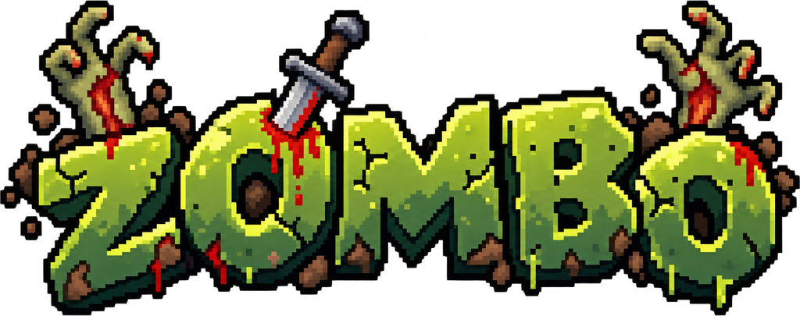

<p align="center">
  
</p>

<p align="center">
  <b>Survive selama mungkin. Pedangmu muter non-stop mengelilingimu.</b>
</p>

<p align="center">
  
  
  
  
</p>

---

## Tentang ZOMBO

**ZOMBO** adalah game survival pixel-art 2D top-down (Flutter + Flame). Kamu adalah satu-satunya survivor di arena yang dikepung zombie dari segala arah. Satu-satunya senjatamu: **sebuah pedang yang berputar tanpa henti** mengelilingimu.

Zombie yang kena pedang akan jatuh dan menjatuhkan **koin**. Koin dipakai untuk **upgrade pedang** jadi lebih besar, lebih sakit, dan lebih cepat. Semakin lama kamu hidup, semakin banyak dan semakin ganas zombienya.

**Skor = waktu survive + kills.** Seberapa lama kamu bisa bertahan?

## Core Loop

```
Gerak → Pedang bunuh zombie → Kumpulin koin → Upgrade pedang → Survive lebih lama
```

## Kontrol

- **Joystick floating** — sentuh di mana saja di layar, joystick muncul di titik itu. Seret untuk gerak, lepas untuk berhenti.
- **Tidak ada tombol serang** — pedang menyerang sendiri, non-stop. Fokusmu cuma satu: **jangan sampai tersentuh zombie.**

## Pedang — Orbit Non-Stop

Pedang berputar tanpa henti mengelilingi karakter. Hit-nya berdasarkan **sudut**: zombie yang sedang dilewati blade (dalam setengah lebar sudut 0,5 rad + band radial blade) kena damage (cooldown 0,35 detik per zombie).

| Tier | Pedang | Damage | Radius | Putaran | Harga |
|------|--------|--------|--------|---------|-------|
| 1 | Besi | 10 | 70 | 5,0 rad/s | — |
| 2 | Api | 22 | 95 | 5,4 rad/s | 30 koin |
| 3 | Petir | 45 | 125 | 6,0 rad/s | 80 koin |

Beli upgrade lewat tombol di bawah layar selama run berjalan. Sprite dan stats pedang langsung berubah.

## Zombie

| Tipe | HP | Speed | Damage Sentuh | Koin |
|------|----|-------|---------------|------|
| Normal | 30 | 55 | 10 | 1 |
| Cepat | 20 | 95 | 8 | 1 |
| Tank | 160 | 32 | 25 | 5 |

- Zombie muncul dari tepi arena, makin lama makin rame (interval 2,0 dtk → 0,7 dtk di menit ke-5, maks 90 zombie hidup).
- Zombie Cepat mulai muncul setelah 30 detik, Tank setelah 90 detik.
- Kena sentuh zombie = HP berkurang + kedip kebal 0,5 detik (i-frames).

## Koin

- Jatuh dari zombie yang mati, dengan animasi spin.
- **Magnet**: koin dalam radius 110 langsung ketarik ke kamu — makin dekat, makin kencang (efek kesedot).
- Koin yang terkumpul dipakai untuk upgrade pedang **di dalam run yang sama**.

## Fitur

- **Joystick floating** — muncul di titik sentuh, di mana saja.
- **Upgrade pedang 3 tier** (Besi → Api → Petir).
- **Best score** tersimpan antar sesi (waktu + kills terbaik, badge "REKOR BARU!" kalau pecah rekor).
- **Juice**: burst partikel saat hit/mati/koin/upgrade, angka damage melayang, screen shake saat kena hit.
- **Audio**: 7 SFX + BGM chiptune loop, tombol mute.
- **Pause menu**: Lanjut / Ulangi / Ke Menu / Mute / Getar.
- **Settings**: mute & getar (haptics) tersimpan antar sesi.
- **Menu utama** dengan logo ZOMBO + best score.
- **Player**: HP 100, speed 200.

## Teknologi

| Stack | Versi |
|-------|-------|
| Flutter | 3.47.7 |
| Flame (game engine) | 1.38.2 |
| flame_audio (SFX + BGM) | 2.12.2 |
| shared_preferences (best score + settings) | 2.5.6 |

Semua angka balance terpusat di `lib/core/balance.dart` — satu file untuk tuning.

## Cara Menjalankan

```bash
# HP Android (perlu Android SDK + USB debugging / emulator)
flutter run

# Cek cepat di browser
flutter run -d chrome

# Build APK release
flutter build apk --release
```

## Struktur Project

```
lib/
├── main.dart                  # Entry point: portrait only, GameWidget + overlay
├── core/
│   ├── balance.dart           # Semua angka balance (pedang, zombie, spawn, koin)
│   └── game_state.dart        # State terpusat (HP, koin, tier, kills, menu/pause)
├── game/
│   ├── zombo_game.dart        # Game utama: wiring, spawn, hit, game over, restart
│   └── components/
│       ├── player_component.dart
│       ├── sword_component.dart        # Pedang orbit
│       ├── zombie_component.dart
│       ├── coin_component.dart
│       ├── spawner_component.dart
│       ├── floating_joystick_component.dart
│       └── fx_component.dart           # Partikel + angka damage
└── ui/
    └── hud_overlay.dart       # HUD, tombol upgrade, pause, menu, game over
assets/
├── images/                    # Sprite + logo (hasil preprocessing)
└── audio/                     # SFX + BGM
```

## Roadmap (v2)

- [x] Scrolling world (kamera ikut player)
- [ ] Boss tiap 5 menit
- [ ] Tipe zombie baru
- [ ] Meta-progression antar run
- [ ] Leaderboard lokal

## Aset & Kredit

- **Sprite, logo, & map**: AI-generated (ChatGPT), preprocessing (trim + downscale + split) sebelum masuk repo.
- **SFX**: [Kenney — RPG Audio](https://kenney.nl/assets/rpg-audio) (CC0, bebas pakai).
- **BGM**: chiptune loop disintesis in-house, bebas lisensi.

---

<p align="center">
  <b>Berapa lama kamu bisa bertahan?</b>
</p>
